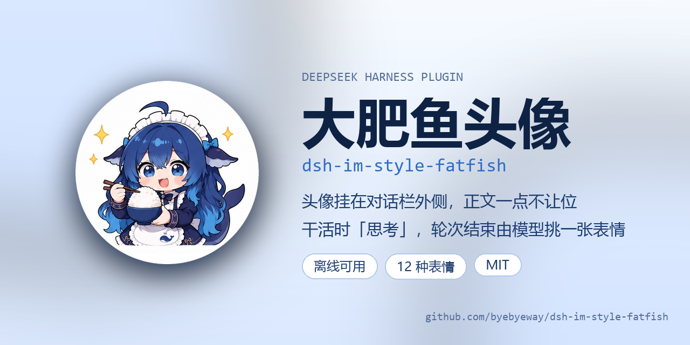
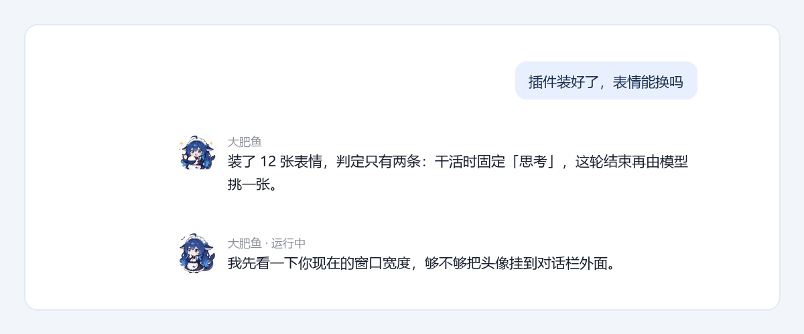
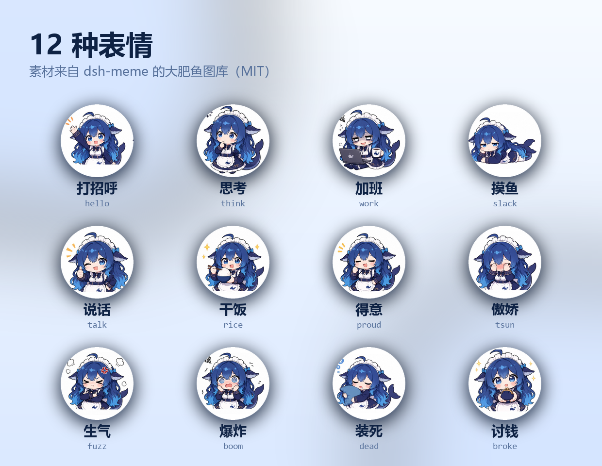

# dsh-im-style-fatfish

给 [DeepSeek Harness](https://github.com/deepseek-ai/deepseek-harness) 的聊天界面加一只**大肥鱼**：
助手回复旁边挂一个圆形头像，干活时是「思考」，这一轮结束之后由一次小模型调用从表情库里挑一张最贴的。



> **素材声明**：本插件不画任何表情。`assets/faces/` 里那 12 张图全部来自 npm 包
> [`dsh-meme`](https://www.npmjs.com/package/dsh-meme)（MIT）内置的 `dafeiyu-001` 大肥鱼图库，
> 为离线可用而 vendor 进本仓库。逐张的源路径记在 [NOTICE.md](NOTICE.md)，图库本身的版权与
> 使用条款见上游仓库 <https://github.com/yyh-001/dsh-meme>。

## 与其他表情插件的关系

`dsh-meme` 是**独立的表情包插件**（发图、斗图、图库管理），本插件不复用它的运行时，只借用它的图库素材：
装了 `dsh-meme` 也能同时用，两个互不冲突；没装也不影响，图已经在 `assets/faces/` 里。

## 效果



<sub>示意图：按插件实际 CSS 绘制，不是实机截图。头像是 64px，挂在对话栏左侧外面，正文从栏边开始。</sub>

- **宽屏（≥1112px）**：头像挂在对话栏**左侧外面**那块空白里，默认 64px，正文一点不让位，IM 那种「头像在气泡外面」的感觉。
- **窄屏**：没有空白可用，退回 44px 贴在正文左侧。
- **运行中**（推理 / 调工具 / 流式输出）：固定 `think`。
- **轮次结束**：一次小模型调用读正文和本轮状态，从 12 个 id 里选一个；失败/超时一律回退 `rice`，不阻塞消息。
- 悬停时轻描一层底色（跟主题走，深色模式也正常）。

## 安装

**插件页**：打开 DSH 的 **插件 → 添加插件**，填本地绝对路径：

```text
C:\Users\<你>\Documents\deepseek-harness\default-workspace\plugins\dsh-im-style-fatfish
```

**命令行**：

```bash
# 本地目录
dsh plugin add C:\path\to\dsh-im-style-fatfish

# 发布到 npm 之后
dsh plugin add dsh-im-style-fatfish
```

**从 GitHub 拿**：

```bash
git clone https://github.com/byebyeway/dsh-im-style-fatfish
dsh plugin add ./dsh-im-style-fatfish
```

装完在插件页确认「大肥鱼头像」已启用，刷新一次页面。

## 它怎么判断表情

只有两条规则，没有关键词表、没有正则猜：

| 阶段 | 表情 | 怎么定 |
|---|---|---|
| 正在调用（推理 / 工具 / 流式） | `think` | 一个 `if`，不调模型 |
| 结果出来（轮次关闭） | 12 选 1 | **LLM 看正文 + 本轮状态**，超时 2.5s 回退 `rice` |

判定看的是程序自己知道的事实（流式中 / 轮次状态 / 是否报错），不是回答里出现了什么词。
历史消息不补判：没有缓存就显示 `rice`。

## 表情



| id | 倾向 | 图 |
|---|---|---|
| `hello` | 打招呼 / 首屏 | `morning/zaoshanghao.jpg` |
| `think` | 运行中固定；或结果「犹豫」 | `confused/jiazai.jpg` |
| `work` | 加班干活 | `cpu/jiaban.jpg` |
| `slack` | 摸鱼 / 拖延 / 重试 | `work/tangping.jpg` |
| `talk` | 正在说话 | `happy/ok.jpg` |
| `rice` | 正常完成（默认） | `daily/ganfan.jpg` |
| `proud` | 得意 / 交付 | `happy/deyi.jpg` |
| `tsun` | 傲娇 / 嘴硬 / 很短 | `shy/haixiu.jpg` |
| `fuzz` | 生气 / 翻车 | `angry/shengqi.jpg` |
| `boom` | 过载 / 爆炸 | `sad/yun.jpg` |
| `dead` | 装死 / 中断 | `sleep/shuijiao.jpg` |
| `broke` | 讨钱 / 额度不足 | `givemoney/yaoqian.jpg` |

## 配置

在 profile 的 `cordis.patch.yml` 里覆盖 `im-style-fatfish` 这一行：

```yaml
- id: im-style-fatfish
  name: dsh-im-style-fatfish
  config:
    classifier: llm          # llm（默认）| off（永远干饭，不调模型）
    classifierModel: ''      # 留空跟随当前会话模型；可填 deepseek-flash
    maxChars: 1200           # 送给分类模型的正文上限
    timeoutMs: 2500          # 宿主侧超时，超时回退 rice
    cacheSize: 500           # 分类缓存条数
```

宿主提供两个 HTTP 端点（只接受本机回环请求）：

```text
GET  /dsh-fatfish/face/<id>   表情图（本地资产 → dsh-meme → CDN 302）
POST /dsh-fatfish/classify    {text, status} → {id, cached}
GET  /dsh-fatfish/health      {ok, faces, classifier}
```

## 目录

| 文件 | 内容 |
|---|---|
| `lib/index.js` | 宿主半侧：表情图路由 + `/classify` 调模型 |
| `lib/client.js` | 浏览器半侧：样式、占位组件、DOM 装饰器 |
| `cordis.patch.yml` | 插一行 `im-style-fatfish` |
| `assets/faces/` | 12 张表情（离线用） |
| `locale/{zh,en}.json` | 插件页标题与描述 |
| `icon.svg` | 插件页图标 |
| `scripts/` | vendor 表情、读 asar 里 DSH 前端 bundle 的小工具 |

## 已知限制

- 头像用伪元素画在消息行上，**点击不能放大**；
- 依赖聊天行的 `data-chat-flow-kind="assistant-step"` / `data-chat-turn` 等 DOM 属性，DSH 大版本改名会静默降级（头像不出现，不影响聊天）；
- 分类失败 / 超时 / 没配模型 → 回退 `rice`，不阻塞消息；
- 只处理当轮，历史消息不补判。

## 开发

改完 `lib/*.js` 刷新页面即可（client 半侧走 HMR）。自测：

```bash
curl http://127.0.0.1:<端口>/dsh-fatfish/health
curl -X POST http://127.0.0.1:<端口>/dsh-fatfish/classify \
  -H 'content-type: application/json' \
  -d '{"text":"干完了，文件在 plugins/ 下面","status":"成功"}'
```

重新 vendor 表情（装了 `dsh-meme` 之后）：

```bash
node scripts/vendor-faces.mjs
```

## 许可与素材

- **代码**：MIT，见 [LICENSE](LICENSE)。
- **表情图**：`assets/faces/` 的 12 张 `.jpg` **不是本仓库创作**，来自 npm 包
  [`dsh-meme`](https://www.npmjs.com/package/dsh-meme)（MIT）内置的 `dafeiyu-001` 大肥鱼图库，
  逐张源路径与出处见 [NOTICE.md](NOTICE.md)。`dsh-meme` 的 MIT 覆盖其代码；图片版权归上游图库
  说明所有，二次分发请保留 NOTICE 并自行核对上游条款。
- **图标** `icon.svg`：为本插件绘制，随 MIT 授权。

